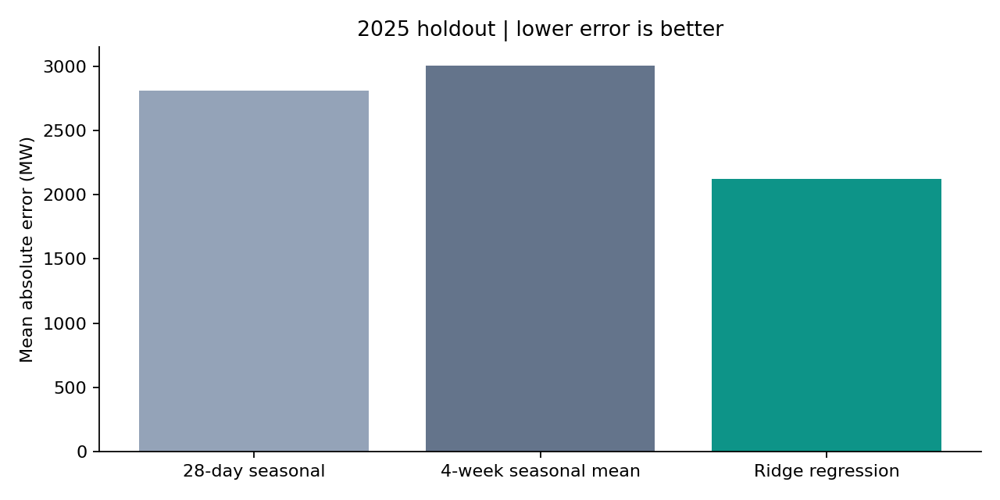

# GB electricity demand forecasting

Can a small, understandable model improve on a seasonal forecast when the public demand feed arrives several weeks late?

This project downloads Great Britain's half-hourly National Demand from NESO, checks settlement timestamps, and evaluates forecasts on a full unseen year. It is a historical backtest, with a local interactive results dashboard.



## Results

Data snapshot: **70,128 half-hourly observations, 2022–2025**. Training uses 2022–2023 after lag warm-up; 2024 selects ridge regularisation and calibrates an empirical error band; 2025 is held out for final evaluation. The model remains fixed throughout 2025.

| Model | 2025 MAE (MW) | RMSE (MW) | WAPE |
|---|---:|---:|---:|
| Same UTC slot 28 days earlier | 2,806.8 | 3,715.1 | 10.73% |
| Average of 28/35/42/49-day lags | 3,001.4 | 3,921.2 | 11.47% |
| Ridge regression | **2,120.2** | **2,800.6** | **8.11%** |

Ridge reduced MAE by **24.46% against the stronger seasonal baseline**, on 17,520 test intervals. This comparison applies to these baselines and this data snapshot; it is not a comparison against NESO's operational forecasting system.

The nominal 90% empirical band covered **84.83%** of test observations. Its undercoverage is a useful finding: residual uncertainty changed between 2024 and 2025. It should not be presented as a calibrated 90% operational interval.

## Run locally

Python 3.13 was used for the recorded run. From this directory:

```bash
python -m venv .venv
# Windows: .venv\Scripts\activate
# macOS/Linux: source .venv/bin/activate
python -m pip install -r requirements.txt
python src/pipeline.py
python -m unittest discover -s tests -v
python src/build_dashboard.py
```

Open `reports/dashboard.html` in a browser. It runs locally without a server or external JavaScript dependencies. Filter by month and inspect daily average actual and predicted demand. The CSV retains all half-hourly predictions.

The first pipeline run downloads four CSVs; subsequent runs reuse them. To refresh, remove the relevant cached files in `data/raw/` and rerun. Upstream revisions may change results. `reports/data_manifest.json` records source URLs, resource IDs and SHA-256 hashes of the exact files used.

## Forecast setup and decisions

- **Target:** NESO's `ND`, measured in MW. This is a specific generation requirement; it is not all electricity consumed in Britain. Read the source definition before interpreting it.
- **Forecast interpretation:** predict all slots of a target day using calendar information and observations at least 28 days old. This is deliberately conservative about public-data availability.
- **Availability:** NESO says this historic dataset is populated 21 days in arrears. A 28-day minimum lag provides a buffer. No same-day wind/solar outturn or next-day weather observations enter the model.
- **Inputs:** 28/35/42/49-day demand lags, a lagged 24-hour mean and standard deviation, daily/annual Fourier terms, weekday indicators and weekday/daily interactions, and daylight-saving status.
- **Model:** standardised ridge regression, implemented with NumPy's linear solver. Five regularisation values are compared using validation MAE. Standardisation is fitted on training data only.
- **Time:** settlement period 1 starts at UK local midnight. Convert that midnight to UTC, then add elapsed half-hours. Spring days contain 46 periods and autumn days 50; treating every local day as 48 periods would misalign observations.
- **Missing data:** preserve missing slots and invalid demand as missing; drop incomplete model rows. Do not interpolate targets across split boundaries. Duplicate timestamps fail the run.
- **Intervals:** a symmetric band based on the 90th percentile of absolute 2024 residuals. It has no guaranteed coverage under temporal drift; the held-out coverage is reported explicitly.

## What worked, and what needs more work

Calendar terms and lagged demand improved on both simple seasonal forecasts. The four-week average performed worse than the single 28-day lag; smoothing older weeks is not automatically useful when demand changes seasonally.

The displayed February week reveals underprediction at several peaks. Weather and public holidays are plausible missing explanations, but this project does not establish their causal contributions. A next experiment would add archived weather forecasts and holiday features, then evaluate a new untouched time period.

Important limits:

1. Downloaded data contains retrospective corrections. There are no historical publication vintages here, so the backtest cannot prove exactly what would have been available on every past forecast date. The 28-day lag addresses the stated normal publication delay, not every revision.
2. Hyperparameter selection and interval calibration share 2024. Coverage on 2025 is an empirical diagnostic, not a guarantee.
3. No weather, holiday features, operational live feed, scheduled deployment or future forecasting service is included. The dashboard displays historical evaluation.
4. The final test year has now been inspected. Further tuning against 2025 would turn it into development data; a subsequent model needs a fresh holdout.

## Repository guide

```text
src/pipeline.py          Download, audit, features, ridge, evaluation and plots
src/build_dashboard.py   Build the standalone local dashboard
tests/test_pipeline.py  Leakage, clock-change, missing-data and numerical checks
reports/metrics.json     Machine-readable validation and test results
reports/data_quality.json
reports/data_manifest.json
reports/test_predictions.csv
reports/monthly_errors.csv
reports/dashboard.html
docs/interview_notes.md
```

## Data source and attribution

Source: **National Energy System Operator (NESO), Historic Demand Data**, yearly files for 2022–2025, retrieved 17 October 2026.

- [Dataset and current quality notices](https://www.neso.energy/data-portal/historic-demand-data)
- [Field definitions](https://www.neso.energy/data-portal/historic-demand-data/historic_demand_data_2025)
- [NESO Open Licence](https://www.neso.energy/data-portal/neso-open-licence)

**Supported by National Energy SO Open Data.** Raw source CSVs are excluded from Git; the downloader retrieves them from NESO. Derived predictions and evaluation summaries are included with this attribution. NESO does not endorse this project. See `DATA_LICENSE.md`.
